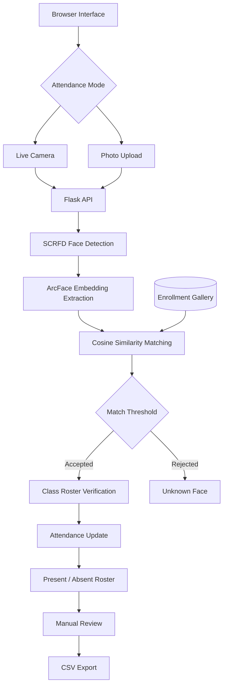

# Face Recognition Attendance System


A browser-based automated attendance system that uses facial
recognition to identify students through live camera feeds and
classroom photographs.

Developed and refined over three years, the project evolved from
traditional machine learning to deep learning and eventually an
InsightFace-based recognition pipeline. The system was accepted
by faculty for live classroom attendance.

## Project Demonstrations

### Automated Attendance Workflow


Demonstration of classroom photo scanning, multi-face
detection, identity recognition, attendance tracking
and CSV export.

### Three Years of Project Evolution


An animated walkthrough of the three generations
of the attendance system, highlighting architectural
changes, technical limitations and improvements.


## Key Features

- Real-time face detection and recognition through a webcam.
- Multiple-face recognition in classroom photographs.
- Batch processing of up to 20 photographs.
- Branch and class-specific attendance sessions.
- Automatic present and absent roster updates.
- Temporal confirmation for live attendance.
- Manual attendance correction.
- Automatic facial embedding generation and caching.
- Student enrollment without classifier retraining.
- CSV attendance export.
- Browser-based interface with recognition bounding boxes.

## Project Evolution

The system was developed across three iterations, with each
version addressing limitations identified in the previous one.

### V1 — Traditional Machine Learning

**Haar Cascade + PCA + SVM**

- Haar Cascade for face detection.
- Image augmentation through flipping, sharpening and blurring.
- PCA for dimensionality reduction of pixel-based features.
- SVM for student classification.

Limitations:
- Sensitive to changes in lighting and facial orientation.
- Dependent on pixel-level features.
- Required classifier retraining when students were added.

### V2 — Deep Learning and AutoML

**MediaPipe / Haar Cascade + FaceNet + SVM**

- Facial detection using MediaPipe and Haar Cascade.
- FaceNet for facial embedding extraction.
- SVM-based identity classification.
- Temporal confirmation to reduce unstable predictions.
- Experimentation with alternative classifiers.

Limitations:
- Small faces in group photographs were sometimes missed.
- False detections could result in incorrect identification.
- Classifier retraining was still required for roster changes.
- Dependency compatibility issues affected deployment.

### V3 — InsightFace (Current Version)

**SCRFD + ArcFace + Cosine Similarity**

- SCRFD for multi-face detection.
- ArcFace for 512-dimensional facial embeddings.
- L2-normalized embeddings for similarity-based matching.
- Cosine similarity for identity verification.
- Automatic gallery rebuilding when enrollment photos change.
- No student-specific classifier training required.

Adding or removing a student now requires only adding or
removing their enrollment folder.

## Architecture



## Recognition Pipeline

### 1. Face Detection — SCRFD

SCRFD detects faces within live video frames and uploaded
photographs, including multiple faces in a single image.

### 2. Feature Extraction — ArcFace

The InsightFace buffalo_l model converts each detected face
into a 512-dimensional normalized embedding.

### 3. Identity Matching — Cosine Similarity

The extracted embedding is compared against registered
facial embeddings in the enrollment gallery.

The best match is accepted when its similarity score meets
the configured threshold of 0.45.

### 4. Roster Verification

The recognized identity is checked against the selected
branch and class roster before attendance is updated.

### 5. Attendance Management

Recognized students are marked present, while remaining
students stay absent. The teacher can manually review and
correct attendance before exporting the final CSV.

## Attendance Modes

### Live Camera

- Continuous webcam-based recognition.
- Frames processed approximately every 1.2 seconds.
- Bounding boxes and recognized identities displayed on screen.
- Consecutive recognition required before marking attendance.

### Photo Upload

- Capture or upload classroom photographs.
- Process up to 20 photographs per batch.
- Detect and identify multiple faces in each photograph.
- Correct image orientation using EXIF information.
- Combine recognized students across multiple photographs.

Both modes support live roster updates, manual correction
and CSV export.

## Experimental Results

| Evaluation Metric | Result |
|---|---:|
| Enrollment dataset | 91 photographs |
| Registered students | 13 |
| Departments | AI and Civil Engineering |
| Leave-one-out recognition | 91/91 |
| Composite group-photo test | 4/4 faces identified |
| Lowest correct-match similarity | 0.58 |
| Recognition threshold | 0.45 |
| CPU processing time at 640 × 640 | ~0.65 seconds/frame |

The recognition test used leave-one-out evaluation.
The group-photo test used a composite of enrollment images.

These results represent controlled experimental evaluation.
The previous pipeline was not benchmarked under identical
test conditions.

## Technology Stack

| Component | Technology |
|---|---|
| Programming Language | Python 3.11 |
| Backend | Flask |
| Frontend | HTML, CSS, JavaScript |
| Face Analysis | InsightFace |
| Face Detection | SCRFD |
| Face Recognition | ArcFace |
| Pretrained Model | buffalo_l |
| Embedding Dimensions | 512 |
| Identity Matching | Cosine Similarity |
| Model Inference | ONNX Runtime |
| Image Processing | OpenCV |
| Attendance Storage | CSV |

## Project Structure

```text
insightface-attendance-system/
│
├── BTECH/                     # Local enrollment dataset
│   ├── AI/
│   │   └── 3/
│   │       └── faces/
│   └── CIVIL/
│       └── 3/
│           └── faces/
│
├── attendance_records/        # Generated attendance records
│
├── demos/
│   ├── face-attendance-demo.html
│   └── face-attendance-story.html
│
├── static/
│   ├── app.js
│   └── style.css
│
├── templates/
│   └── index.html
│
├── app.py
├── requirements.txt
├── .gitignore
└── README.md
```

Enrollment datasets and generated attendance records are
maintained locally and excluded from version control.

## Installation and Setup

### Clone the repository

```bash
git clone https://github.com/DhruvMarwal/insightface-attendance-system.git
cd insightface-attendance-system
```

### Create a virtual environment

```bash
py -3.11 -m venv venv311
```

Activate the environment on Windows:

```powershell
.\venv311\Scripts\Activate.ps1
```

### Install dependencies

```bash
pip install -r requirements.txt
```

### Prepare the enrollment dataset

Organize reference photographs using the following structure:

```text
BTECH/
└── AI/
    └── 3/
        └── faces/
            ├── Student_01/
            │   ├── image1.jpg
            │   └── image2.jpg
            └── Student_02/
                ├── image1.jpg
                └── image2.jpg
```

Use approximately 5–15 clear reference photographs per student.

Facial embeddings are automatically generated and cached
in _gallery.npz. The gallery is rebuilt when enrollment
photographs change.

### Run the application

```bash
python app.py
```

Open:

http://localhost:5000

The first run downloads the InsightFace buffalo_l model
(approximately 280 MB).

On Windows, installing InsightFace may require Microsoft
C++ Build Tools.

Camera access requires localhost or HTTPS.

## Configuration

The following environment variables can be used to tune
recognition performance.

| Parameter | Default | Description |
|---|---:|---|
| MATCH_THRESHOLD | 0.45 | Minimum cosine similarity for identity matching |
| LIVE_CONFIRM | 2 | Consecutive live scans required to mark attendance |
| DET_SIZE | 1280 | Face detection input size |

Increasing the matching threshold makes identity matching
stricter. Increasing detection size can improve detection
of smaller faces at the cost of processing speed.

## Current Limitations and Future Improvements

- Liveness detection and anti-spoofing.
- Larger-scale classroom evaluation.
- GPU-accelerated inference.
- Persistent database-backed attendance sessions.
- Teacher authentication and access management.
- Historical attendance analytics.

## Acknowledgements

Developed collaboratively as part of an academic computer
vision project, with successive improvements based on
experimentation, testing and classroom requirements.

Built using InsightFace, OpenCV, Flask and ONNX Runtime.
